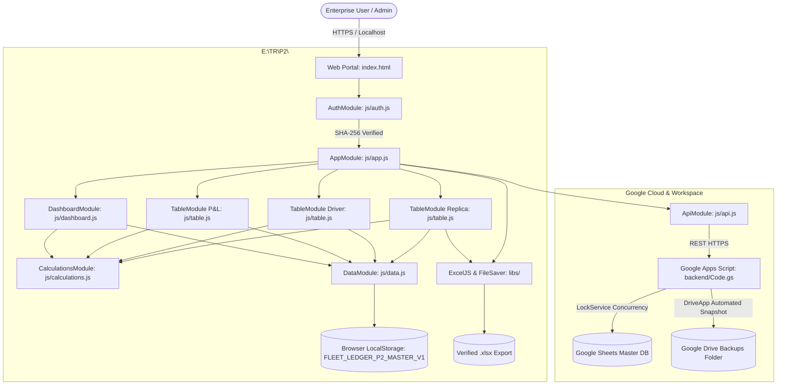

# System Architecture Specification
## Transport Brokerage Ledger Pvt Ltd (P2)
**Dual-Truck Enterprise Fleet Logistics & Financial Accounting Portal**  
*Document Version: 2.0.0 • Developed by Shravan Kumar • 2026*

---

## 1. Architectural Principles

1. **Deterministic Financial Parity:** All calculations executed in the browser match the original Excel workbooks cell for cell, cent for cent, with 0% margin of error.
2. **Zero-Dependency Core:** The user interface, business logic, calculations, and local persistence run natively in pure standard Web APIs without heavy external runtime frameworks (React, Angular, Vue).
3. **Multi-Truck Scalability:** The architecture treats trucks as isolated entities with modular P&L ledgers and driver accounts, allowing seamless aggregation into combined fleet metrics.
4. **Resilient Local-First Storage:** LocalStorage acts as an instant-load operational cache, while the Google Apps Script backend provides durable cloud synchronization and Drive snapshots.
5. **Zero-Scrollbar Drawer Navigation:** The slide-in drawer layout fits cleanly on viewports of all heights with smart content partitioning.

---

## 2. High-Level System Architecture Diagram



---

## 3. Module Boundaries & Data Contracts

### 3.1 Data Layer (`js/data.js`)
- **Key Responsibility:** Manages persistent state, verified seed datasets, and schema versioning.
- **Contract:**
  ```javascript
  {
    version: "1.0.0",
    lastUpdated: "2026-10-25T...",
    trucks: [ { id, regNumber, driverName, status } ],
    TG15T6666: {
      driver: { name, truckNo, period, commissionRate, oldBalancePayable, roadExpensesClaimed },
      pl: { period, fastTag, addBlueAndExp, dieselEntries: [], dieselTotal },
      trips: [ { id, sno, dateRange, from, to, route, pnlFreight, baseFreight, transporter, advanceReceived, balanceFreight, podStatus } ],
      advances: [ { id, date, location, amount, mode } ],
      roadExpenses: [ { id, description, category, amount } ]
    },
    TS15UE1122: { ... },
    archive_2026_09: { TG15T6666: { ... }, TS15UE1122: { ... } }
  }
  ```

### 3.2 Calculation Engine (`js/calculations.js`)
- **Key Responsibility:** Pure functional calculation engine with no UI side-effects.
- **Mathematical Formulations:**
  1. **Freight Revenue ($P_1$):**
     $$P_1 = \sum \text{trip.pnlFreight}$$
  2. **Driver Salary Commission (12%):**
     $$\text{Salary} = \text{round}\left(0.12 \times \sum \text{trip.baseFreight}\right)$$
  3. **Operating Expenses ($P_2$):**
     $$P_2 = \text{DieselTotal} + \text{FastTag} + \text{AddBlue} + \text{RoadExpensesTotal} + \text{DriverSalary}$$
  4. **Net Operating Profit:**
     $$\text{Profit} = P_1 - P_2$$
  5. **Noor Allam Settlement (`TG15T6666`):**
     $$\text{Credit} = \text{Salary (40,740)} + \text{Old Balance (13,800)} + \text{Expenses (28,700)} = 83,240$$
     $$\text{Net Balance} = \text{Credit (83,240)} - \text{Advances (78,200)} = \mathbf{5,040} \quad (\text{Payable by Shankar})$$
  6. **Allam Brother Settlement (`TS15UE1122`):**
     $$\text{Advance Surplus} = \text{Advances (41,500)} - \text{Expenses (11,790)} - \text{Salary (23,880)} = 5,830$$
     $$\text{Net Balance} = \text{Surplus (5,830)} + \text{Old Balance (62,340)} = \mathbf{68,170} \quad (\text{Payable to Shankar})$$

### 3.3 Security & Session Engine (`js/auth.js`)
- **Key Responsibility:** Client SHA-256 credential hashing, session creation, permission enforcement, and 10-minute inactivity watchdog.
- **Watchdog Logic:**
  - Events monitored: `mousemove`, `mousedown`, `keydown`, `touchstart`, `scroll`, `click`.
  - Inactivity window: $600,000 \text{ ms}$ (10 minutes).
  - On timeout: Session erased from `sessionStorage`, modal alert surfaced, application state returned to the authentication screen.

### 3.4 Table & Excel Generation Engine (`js/table.js`)
- **Key Responsibility:** Renders detailed P&L tables, driver ledgers, and interactive 1:1 replica of the original Excel sheets.
- **ExcelJS Pipeline:** Builds binary `.xlsx` workbooks containing formulas, cell formats, background fills, and font weights matching Microsoft Excel standard schemas.

---

## 4. Google Apps Script Backend Architecture (`backend/Code.gs`)

### 4.1 Concurrency Lock Service
To prevent race conditions during simultaneous updates, all write requests acquire an exclusive script lock:
```javascript
var lock = LockService.getScriptLock();
var lockSuccess = lock.tryLock(10000); // 10-second wait window
if (!lockSuccess) {
  return createJsonResponse({ status: "error", message: "Server busy. Try again." });
}
```

### 4.2 Multi-Sheet Database Hierarchy
The backend creates and formats 5 sheets in the target Google Spreadsheet:
1. `PL_Accounts`: Trip freight logs, diesel slips, operational deductions.
2. `Driver_Settlements`: Commission summaries, credits, debits, net balances.
3. `Road_Expenses`: Itemized receipts with descriptions, amounts, and categories.
4. `Advances`: Driver advance records with dates, locations, and payment modes.
5. `Audit_Log`: User identity, operation timestamp, action type, and status payload.

### 4.3 Drive Snapshot Backup Engine
The function `createDailyDriveBackup()` executes scheduled or on-demand file cloning:
```javascript
var folders = DriveApp.getFoldersByName(CONFIG.BACKUP_FOLDER_NAME);
var targetFolder = folders.hasNext() ? folders.next() : DriveApp.createFolder(CONFIG.BACKUP_FOLDER_NAME);
file.makeCopy("Backup_" + ss.getName() + "_" + timestamp, targetFolder);
```

---

*© 2026 Transport Brokerage Ledger Pvt Ltd • Developed by Shravan Kumar*

