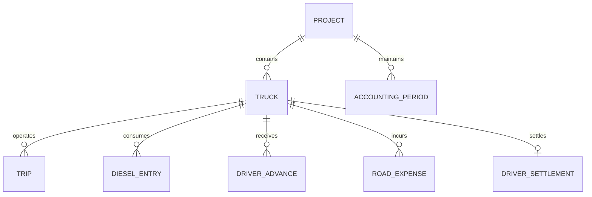

# Database Architecture & Google Sheets Schema
## Transport Brokerage Ledger Pvt Ltd (SR Transport)

---

## 1. Multi-Project & Multi-Truck Architecture

The application is structured around isolated projects. Each project maintains its own configuration, trucks, accounting periods, and dedicated Google Spreadsheet.

---

## 2. Google Sheets Tab Schema (1 Spreadsheet per Project)

Each project connects to a dedicated Google Spreadsheet with the following 12 tabs:

### 1. `Project_Settings`
| Column | Type | Example | Description |
| :--- | :--- | :--- | :--- |
| `Key` | String | `PROJECT_ID` | Configuration key |
| `Value` | String | `PRJ-001` | Configuration value |
| `Updated_At` | ISO String | `2026-10-31T14:00:00Z` | Timestamp |

### 2. `Fleet`
| Column | Type | Example | Description |
| :--- | :--- | :--- | :--- |
| `Truck_ID` | String | `TG15T6666` | Primary key |
| `Registration`| String | `TG15T6666` | Vehicle Registration Number |
| `Driver_Name` | String | `Noor Allam` | Current assigned driver |
| `Driver_Phone`| String | `+91 98480 12345` | Contact details |
| `Status` | String | `Active` | `Active` or `Inactive` |
| `FastTag_Fixed`| Number | `40000` | Monthly allocated FastTag amount |
| `AddBlue_Fixed`| Number | `15000` | Monthly allocated AddBlue / Maintenance |
| `Updated_At` | ISO String | `2026-10-31T14:00:00Z` | Timestamp |

### 3. `Drivers`
| Column | Type | Example | Description |
| :--- | :--- | :--- | :--- |
| `Driver_ID` | String | `DRV-001` | Primary key |
| `Name` | String | `Noor Allam` | Driver name |
| `Phone` | String | `+91 98480 12345` | Phone number |
| `Assigned_Truck`| String | `TG15T6666` | Truck ID |
| `Status` | String | `Active` | Active status |

### 4. `Trips` ($P_1$ Revenue)
| Column | Type | Example | Description |
| :--- | :--- | :--- | :--- |
| `Trip_ID` | String | `T-6666-01` | Unique Trip ID |
| `Project_ID` | String | `PRJ-001` | Project ID |
| `Truck_ID` | String | `TG15T6666` | Foreign Key to Fleet |
| `Date` | Date String | `2026-10-01` | Primary transaction date |
| `Date_Range` | String | `01-10-26 TO 06-10-26` | Origin to destination dates |
| `Period` | String | `2026-10` | Accounting period (`YYYY-MM`) |
| `From_City` | String | `MDCL` | Origin location |
| `To_City` | String | `MADHAPURA` | Destination location |
| `PnL_Freight` | Number | `175000` | Full contract freight ($P_1$) |
| `Base_Freight`| Number | `140000` | Base freight eligible for 12% commission |
| `Transporter` | String | `SR TRSP` | Transporter / broker name |
| `Advance_Received`| Number | `130000` | Direct freight advance |
| `Balance_Due` | Number | `45000` | `=PnL_Freight - Advance_Received` |
| `Status` | String | `Delivered` | Trip status |

### 5. `Diesel_Entries` ($P_2$ Fuel)
| Column | Type | Example | Description |
| :--- | :--- | :--- | :--- |
| `Diesel_ID` | String | `D-6666-01` | Unique Fuel Entry ID |
| `Project_ID` | String | `PRJ-001` | Project ID |
| `Truck_ID` | String | `TG15T6666` | Foreign Key to Fleet |
| `Date` | Date String | `2026-10-02` | Transaction date |
| `Period` | String | `2026-10` | Accounting period |
| `Pump_Location`| String | `HPCL Highway Plaza`| Station / Vendor |
| `Amount` | Number | `30500` | Fuel spend in ₹ |

### 6. `Driver_Settlements`
| Column | Type | Example | Description |
| :--- | :--- | :--- | :--- |
| `Settlement_ID`| String | `SET-6666-2026-10` | Unique settlement ID |
| `Project_ID` | String | `PRJ-001` | Project ID |
| `Truck_ID` | String | `TG15T6666` | Foreign Key to Fleet |
| `Period` | String | `2026-10` | Accounting period |
| `Base_Freight_Total`| Number | `339500` | Sum of base freight |
| `Commission_12Pct` | Number | `40740` | `=ROUND(Base_Freight * 0.12, 0)` |
| `Advances_Total` | Number | `78200` | Sum of advances |
| `Road_Expenses_Total`| Number | `28735` | Itemized road expense sum |
| `Claimed_Expenses` | Number | `28700` | Claimed expenses (if variance) |
| `Reconciliation_Diff`| Number | `35` | Difference between itemized & claimed |
| `Old_Balance` | Number | `13800` | Brought-forward balance |
| `Direction` | String | `PAYABLE_TO_DRIVER` | Direction of payment |
| `Net_Balance` | Number | `5040` | Final payable / receivable amount |
| `Settlement_Date` | Date String | `2026-10-20` | Settlement audit date |

### 7. `Road_Expenses` (Itemized Receipts)
| Column | Type | Example | Description |
| :--- | :--- | :--- | :--- |
| `Expense_ID` | String | `EXP-6666-01` | Unique Expense ID |
| `Project_ID` | String | `PRJ-001` | Project ID |
| `Truck_ID` | String | `TG15T6666` | Truck ID |
| `Date` | Date String | `2026-10-02` | Transaction date |
| `Period` | String | `2026-10` | Accounting period |
| `Description`| String | `HYD KANTA` | Narration |
| `Amount` | Number | `400` | Amount in ₹ |
| `Category` | String | `Kanta / Weighbridge` | Category for audit |

### 8. `Advances`
| Column | Type | Example | Description |
| :--- | :--- | :--- | :--- |
| `Advance_ID` | String | `ADV-6666-01` | Unique Advance ID |
| `Project_ID` | String | `PRJ-001` | Project ID |
| `Truck_ID` | String | `TG15T6666` | Truck ID |
| `Date` | Date String | `2026-10-02` | Transaction date |
| `Period` | String | `2026-10` | Accounting period |
| `Location` | String | `NAGAPUR ADV` | Narration / pump slip |
| `Amount` | Number | `5000` | Amount in ₹ |
| `Mode` | String | `Cash` | `Cash`, `UPI`, `Bank Transfer`, `Dhaba` |

### 9. `PL_Accounts` (Monthly Aggregate Summary)
| Column | Type | Example | Description |
| :--- | :--- | :--- | :--- |
| `Period` | String | `2026-10` | Accounting period |
| `Truck_ID` | String | `TG15T6666` | Truck ID |
| `Revenue_P1` | Number | `382800` | Total Freight |
| `Expenses_P2`| Number | `257075` | Total Operating Expenses |
| `Net_Profit` | Number | `125725` | `=Revenue_P1 - Expenses_P2` |
| `Margin_Pct` | Number | `32.84` | Profit margin percentage |

### 10. `Monthly_Archives`
Stores serialized snapshots of closed accounting periods (`2026-09`, etc.) to prevent accidental modification without administrator unlocking.

### 11. `Audit_Log`
Tracks every record creation, modification, deletion, restore, and cloud synchronization with timestamp, user identity, action, and target record ID.

### 12. `_Meta`
Tracks `DATA_VERSION` (monotonically increasing integer), `LAST_UPDATED` (ISO timestamp), and `LAST_SYNCED_USER`.

